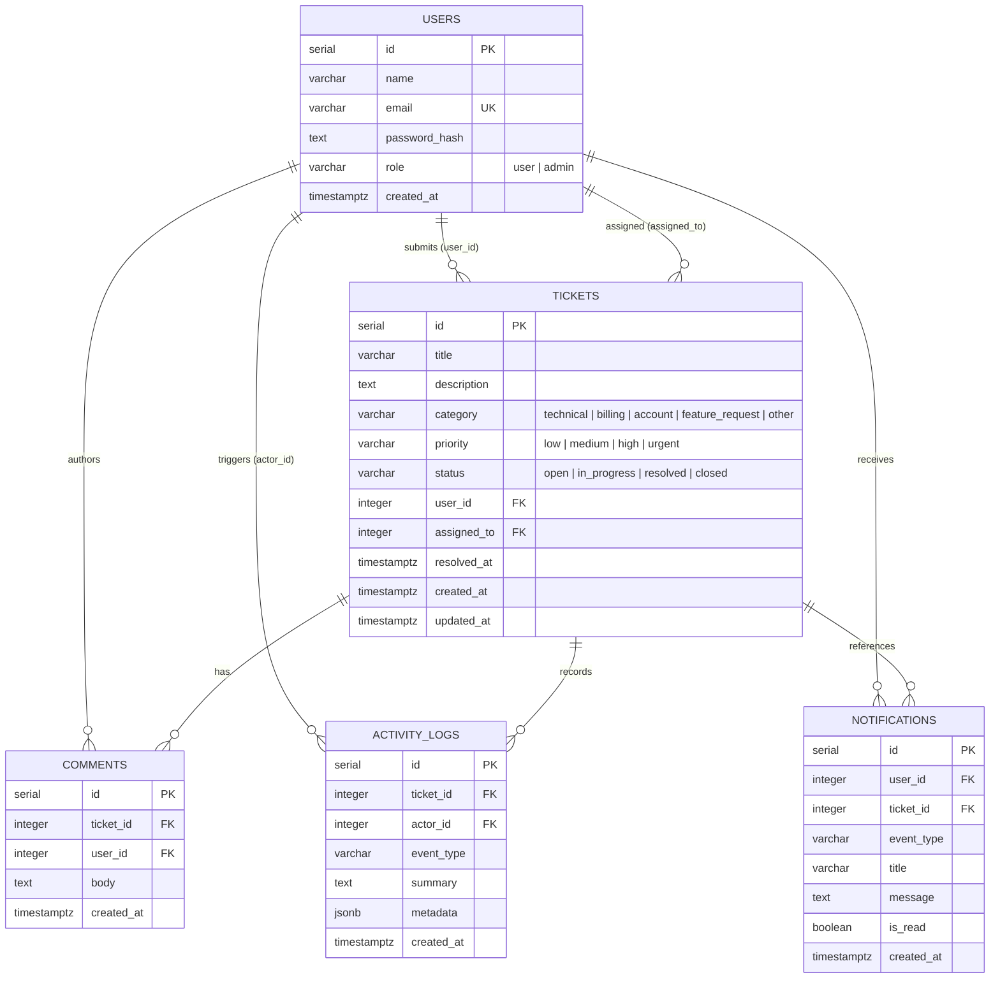

# Database Design — RelayDesk

RelayDesk uses a normalized PostgreSQL relational schema (`server/src/db/schema.sql`) designed for clear ownership boundaries, fast ticket queue filtering, and an immutable audit trail.

## Entity Relationship Diagram

## Table Breakdown & Rationale

1. **`users`**: Stores account identity, `bcryptjs` password hash, and role (`user` or `admin`) enforced via a `CHECK` constraint. `email` has a `UNIQUE` index for O(log n) lookup during login and conflict detection.
2. **`tickets`**: Core domain entity with `user_id` (`ON DELETE CASCADE`) and nullable `assigned_to` (`ON DELETE SET NULL` so unassigning or removing a staff user does not delete customer tickets). `resolved_at` captures resolution timestamp for SLA/resolution metrics.
3. **`comments`**: Threaded responses tied to both `ticket_id` and `user_id`. Joining `users` on read returns the author's name and role so the UI can distinguish staff responses from customer replies.
4. **`activity_logs`**: Append-only audit stream written by `TicketEventBus` listeners. A `JSONB metadata` column captures structured field diffs (such as `{ "from": "open", "to": "resolved" }`) without requiring schema migrations for new event attributes.
5. **`notifications`**: User-scoped inbox alerts generated by domain events, indexed by `(user_id, is_read)` to keep unread badge counts fast.

## Indexing Strategy
- `idx_tickets_user_id`: Accelerates user-scoped ticket queries (`GET /api/tickets` for standard users).
- `idx_tickets_status` & `idx_tickets_priority`: Supports admin queue filtering.
- `idx_tickets_created_at`: Speeds up default newest-first pagination.
- `idx_comments_ticket_id` & `idx_activity_ticket_id`: Optimizes ticket detail page loads.
- `idx_notifications_user_read`: Composite index for unread notification counts.
